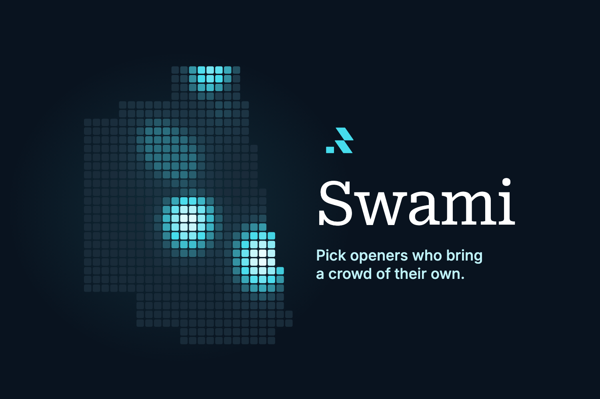
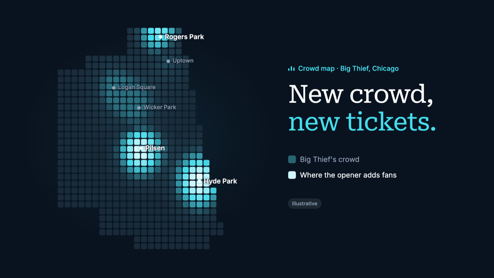
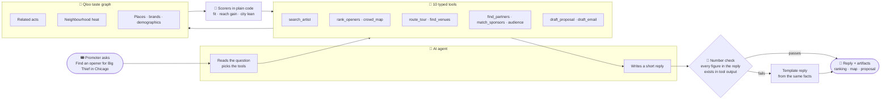
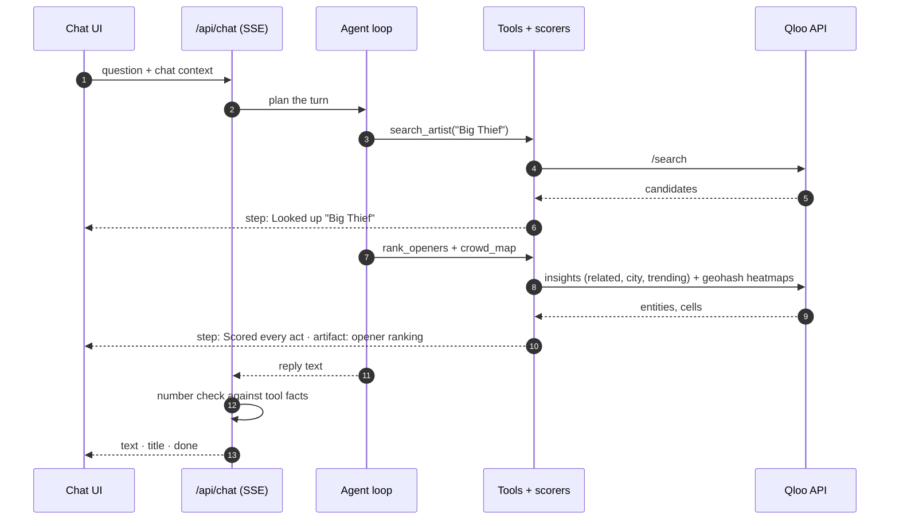

<div align="center">



# Swami

**The AI booking agent for live music, built on Qloo's taste graph.**
Ask who should open the show. Get the act whose fans live where your headliner sells thin, mapped by neighbourhood, with the proposal already drafted.

[](https://swami-eta.vercel.app)
[](https://www.qloo.com)
[](LICENSE)


[Why](#why-swami) · [What it does](#what-it-does) · [How it works](#how-it-works) · [Scoring](#the-scoring) · [Qloo](#what-makes-it-qloo-powered) · [Run it](#run-it-locally) · [Deploy](#deploy) · [Roadmap](#roadmap)

</div>

---

## Why Swami

Every tour date has a support slot, and on most dates a local promoter or talent buyer fills it. The opener has one job: bring in people who would have stayed home for the headliner alone. That pick usually comes from gut feel and an agency list.

Swami answers it with taste data. It asks Qloo two questions:

1. **Whose fans already love this headliner?** That is fit.
2. **Whose fans live in the parts of town where the headliner is thin?** That is reach.

The act that scores well on both fills the room early and sells tickets the headliner would have left on the table.

<p align="center"></p>
<p align="center"><sub>The crowd map moment: dim blocks are the headliner's crowd, bright blocks are where the opener adds fans. (Still from the pitch video, illustrative.)</sub></p>

## What it does

Ask in a chat. The answer streams back as a short message plus **artifacts**: documents you can edit, save to a project, share with your team and export.

| Artifact | Ask it like | What you get |
| --- | --- | --- |
| 🎤 **Opener ranking** | *Find an opener for Big Thief in Chicago, Mar 14.* | Acts ranked by fan fit × reach gain, a reason per act, rising acts flagged, bigger-than-headliner acts demoted |
| 🗺️ **Crowd map** | *Where would Lucy Dacus add crowd for Big Thief?* | Neighbourhoods where the headliner sells and where the opener adds people |
| 🚐 **Tour routing** | *Which cities should Big Thief play on a Midwest leg?* | Cities ranked by fan strength, ordered into a drivable leg, room-size band per stop |
| 🏛️ **Venues** | *Which venue fits Big Thief in Chicago for 1,100 people?* | Rooms the crowd already goes to, sized to the act: clubs to stadiums, in the US and beyond (Jakarta works) |
| 🤝 **Co-promo partners** | *Find co-promo partners in Chicago.* | Bars, restaurants, record shops and cafés in the neighbourhoods the opener adds |
| 💸 **Sponsors** | *Find sponsors whose customers love Big Thief.* | Brands the fans over-index on, with an activation idea each |
| 👥 **Audience** | *Who is the audience for Big Thief? Age and gender.* | Age and gender profile against the general population |
| 📝 **Proposal** | *Write a proposal to Big Thief management.* | An editable pitch with the pick, the alternates and the reasons, in three templates |
| ✉️ **Email** | *Draft an email to hold Mar 14 at the venue.* | A ready venue hold or outreach email |

**And around the answers:**

- 💬 **Follow-ups that remember.** *"What about Austin?"*, *"drop Phoebe Bridgers"*, *"now the venues"* reuse the show and the opener.
- 🃏 **Picture cards for ambiguous names**, with *None of these* when Qloo found someone else.
- ⏱️ **Live steps** while it works, plus Stop, Try again, copy, undo, and editing a question with the old answer kept as a version.
- 🗂️ **A results panel** with scrollable, closable tabs grouped by question.
- 📁 **Projects, rosters and workspaces** on Supabase, with invites and Viewer roles.
- 🔢 **Numbers you can trust.** The AI writes the words; every figure comes from code and is checked before you see it.

## How it works



One chat turn, step by step:



**Every part has a fallback**, so the app always answers:

| Missing | Swami uses instead |
| --- | --- |
| Qloo key | A hand-written fake taste graph, labelled **Demo data** everywhere |
| Model key | A regex router and prose templates built from the same facts |
| Supabase | A workspace kept in the browser |
| One tool fails | A failed step in the timeline while the rest of the answer returns |

## The scoring

All scorers live in [`src/lib/score/`](src/lib/score): pure functions with unit tests, no I/O.

| Score | Formula | Plain words |
| --- | --- | --- |
| **Fit** | position in the headliner's related list, `0.6 · city + 0.4 · global` | How highly the headliner's fans rank this act, in this city and overall |
| **Reach gain** | per neighbourhood `max(0, opener − 0.9 · headliner)`, weighted by popularity | How much of the act's crowd lives where the headliner is thin |
| **Opener score** | `fit^0.6 · reachGain^0.4` | Both matter; fit a little more |
| **Size guard** | demote when `1 − act < 0.75 · (1 − headliner)` on popularity | An act that outdraws the headliner is a co-headliner |
| **City lean** | popularity-weighted mean of `affinity_rank` across a city's geohash cells | How strongly a whole city leans toward the act, comparable across cities |

**The number check** ([`src/lib/agent/prose.ts`](src/lib/agent/prose.ts)): every number in the reply must appear in a tool result or in the user's own words (percentages of 0–1 values and trailing zeros included). A reply that fails is replaced by a template written from the same facts.

## What makes it Qloo-powered

Swami's agent asks its questions of Qloo's taste graph. Every artifact comes from Qloo data run through Swami's scorers, and three things Qloo does are what make each answer possible:

1. **One fan, every domain.** Qloo connects what the same people love across music, places and brands. Seeded with one headliner, the same fan base answers who should open, which bars and record shops to partner with, which brands to pitch and who the audience is. Swami asks one taste graph and gets the whole show plan from it.
2. **Taste with an address.** Qloo's heatmap says where in a city a taste lives, block by block. That is the crowd map, the reach gain inside the opener score, and the city strength behind tour routing.
3. **Signals that steer the question.** A city as a signal gives local taste, a trend bias surfaces acts on the rise, and a list of entities scores a manager's own roster against the headliner's fans.

| Feature | Qloo capability behind it |
| --- | --- |
| Opener ranking | Related artists for the headliner, globally and with the city as signal; trend bias for rising acts; roster scoring with `filter.results.entities` |
| Crowd map and reach gain | Neighbourhood heatmaps for headliner and opener on geohash cells, named with locality insights |
| Tour routing | The headliner's heatmap per city, compared on heat rank |
| Venues | Places the fans love, filtered by venue tags sized to the act |
| Co-promo partners | Bars, restaurants, record shops and cafés the opener's fans love, inside the neighbourhoods it adds |
| Sponsors | Brand affinity of the headliner's fans |
| Audience | Demographics for the headliner's fans |
| Proposal and email | Written from the facts above, so every pick and reason traces back to Qloo |

### The calls in detail

| Qloo call | Used for |
| --- | --- |
| `GET /search` | Resolving artist names, with picture cards when several match |
| `/v2/insights` + `signal.interests.entities` | Acts the headliner's fans love (fit), places and brands they love |
| `signal.location.query` | The same list with the city as a signal |
| `bias.trends=high` | Spotting acts that climb when trends are weighted (rising) |
| `filter.results.entities` | Scoring a manager's own roster, including acts outside the top 50 |
| `filter.type=urn:heatmap` + `output.heatmap.boundary=urn:geohash` | Neighbourhood heat for crowd maps and city strength for routing |
| `filter.type=urn:entity:locality` | Naming neighbourhoods so each heat cell gets a real name |
| `filter.type=urn:demographics` | The audience profile |
| `filter.tags` (music venue, concert hall, bar, record shop…) | Venues and co-promo partners |

Responses are cached in memory and, with Supabase, in a `qloo_cache` table. A run has a call budget and the client keeps at most six requests in flight.

## Run it locally

**Needs:** Node 24 or newer (scripts run TypeScript directly).

```bash
git clone https://github.com/youvandra/Swami.git
cd Swami
npm install
cp .env.example .env.local   # every key is optional
npm run dev                  # http://localhost:5192
```

With an empty `.env.local` the whole app runs on the fake taste graph, writes replies from templates and keeps your workspace in the browser. Each key switches one part on:

| Key | Switches on |
| --- | --- |
| `QLOO_API_KEY`, `QLOO_BASE_URL` | Live taste data |
| `ANTHROPIC_API_KEY`, `SWAMI_MODEL` | The agent on Claude |
| `LLM_BASE_URL`, `LLM_API_KEY`, `LLM_MODEL` | The agent on any OpenAI-compatible endpoint |
| `NEXT_PUBLIC_SUPABASE_URL`, `NEXT_PUBLIC_SUPABASE_ANON_KEY` | Accounts, shared workspaces, daily limits |
| `SUPABASE_SERVICE_ROLE_KEY` | The persistent Qloo cache, invite emails, the smoke test account |
| `NEXT_PUBLIC_AUTH_GOOGLE` | `1` shows Continue with Google, once the provider is on in Supabase |
| `SWAMI_DAILY_RUNS_PER_WORKSPACE` | Daily run limit per workspace (default 200) |
| `SMOKE_EMAIL`, `SMOKE_PASSWORD` | A test-only account `npm run smoke` signs in with when accounts are on |
| `SWAMI_DEV_NO_AUTH` | Local development only: chat without a session (ignored in production) |

<details>
<summary><b>Supabase setup</b></summary>

1. Create a project and apply the migrations in order: `supabase/migrations/0001_init.sql`, `0002_accept_invites.sql`, `0003_message_branches.sql` (SQL editor, or `supabase db push`).
2. Under **Authentication**, enable email links (and Google if you like). Add `<site>/auth/callback` to the redirect URLs.
3. Set the three Supabase keys. A first login creates a workspace; an invited email joins the inviting workspace.

`npm run test:rls` proves the row-level security on a throwaway local Postgres (needs `initdb`, `pg_ctl` and `psql`).

</details>

### Scripts

| Command | Does |
| --- | --- |
| `npm run dev` | Dev server on :5192 |
| `npm run check` | Typecheck, unit tests, production build |
| `npm test` | Unit tests: scorers, tools, router, agent loop, parsers, markdown |
| `npm run smoke` | Asks a running server one question per artifact type and validates every stream (signs in with `SMOKE_EMAIL` when accounts are on) |
| `npm run test:rls` | Row-level security checks on a local Postgres |
| `npm run probe` | Live Qloo probe; raw responses go to `fixtures/real/` (gitignored) |
| `node scripts/build-demo-seed.ts` | Rebuilds the demo chats from the fake graph |

## Deploy

- **Vercel:** import the repo, add the env vars, set `NEXT_PUBLIC_SITE_URL` to the production URL, and add the production and preview domains to Supabase's redirect URLs.
- **Your own server:** `npm ci && npx next build`, copy to `/opt/swami`, then use [`deploy/swami.service`](deploy/swami.service) and [`deploy/nginx.conf`](deploy/nginx.conf). The nginx site turns buffering off for `/api/chat`, which streams.

## Project layout

```text
src/
├── app/                  routes: landing, /app, /login, /print, /api/{chat,bootstrap,sync,status,usage,workspace}
├── components/
│   ├── app/              chat, artifact panel, artifact views, projects, settings, onboarding
│   └── landing/          the marketing page
└── lib/
    ├── agent/            router, agent loop, prompts, prose templates, number check, events
    ├── tools/            the 10 tools and their zod schemas
    ├── score/            pure scorers: opener, heat, routing, venues, partners, sponsors, size
    ├── qloo/             live client, fake-graph source, call budget, cache
    ├── db/               Supabase clients, sync, row mapping, usage limits
    └── site.ts           product name and shared copy
fixtures/fake/            the invented taste graph used without a Qloo key
supabase/migrations/      schema and row-level security
scripts/                  smoke, probe, RLS test, demo seed
```

## What live data taught us

- **Geohash beats polygons.** Named-locality heatmaps return every polygon (4.6 MB, over 90 s for Chicago). Geohash cells answer in about 3 s, and each cell takes the nearest neighbourhood's name. An opener answer went from over two minutes to about ten seconds.
- **Rank compares cities, affinity compares blocks.** Heat affinity is rescaled inside each city; `affinity_rank` holds across cities, so tours rank on it.
- **Qloo's order already accounts for popularity.** Seeded affinities in a top 50 sit within 0.03 of each other, so position in the list carries the signal for fit.
- **Small samples mislead.** One airport block once looked like a band's stronghold, so a neighbourhood now needs at least five cells to count.

## Roadmap

- [ ] Ticketing and streaming data next to taste data
- [ ] Promo links per opener that show what each act actually sold
- [ ] One-step agency roster import
- [ ] Venues and neighbourhoods for more cities outside the US
- [ ] Per-show pricing

## Honest data

Everything in `fixtures/fake/` is invented: artists, venues, brands and numbers, and the app labels it **Demo data**. Raw Qloo responses stay out of git. Pricing on the landing page is a placeholder.

## License

[MIT](LICENSE) © 2026 youvandra
